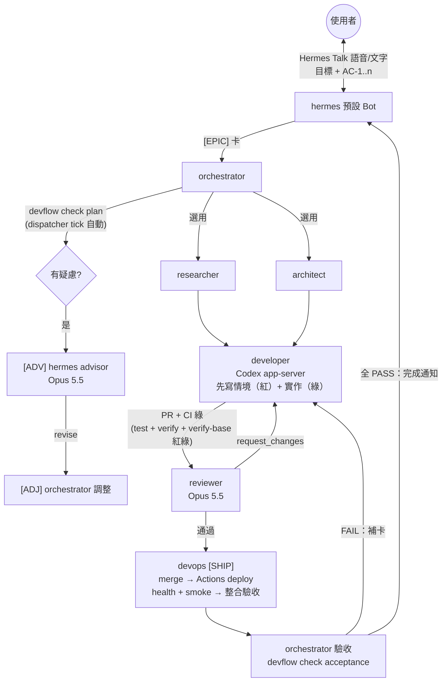

# devflow｜Hermes 七 Bot 共用開發流程

適用任何新 repo 或既有 repo。只用 Hermes 原生功能（Kanban、dispatcher、profile、skills、Codex app-server runtime）與 Hermes Talk 語音 plug-in，不改 Hermes 程式。

## 流程

- **一個 repo = 一個 Kanban board**；卡片依賴就是流程，dispatcher（default gateway 內）依依賴自動派工。
- 卡片 body（目標/驗收/提示）是規格；`kanban_complete` / `kanban_request_review` 的 summary + metadata 是交接。沒有額外交接文件。
- **驗收貫穿全程**：Hermes 把「怎樣算完成」寫成編號 `AC-n` 並標類型（`[ui]`/`[api]`/`[cli]`/`[lib]`/`[manual]`，語音確認一次）→ orchestrator 把每條展開成 Given/When/Then 情境 `<EPIC>/AC-n.Sm` → developer 先寫可執行情境再實作 → 證據鏈見下方「驗收證據鏈」，全 PASS 才完成 EPIC。
- **計畫檢查**：EPIC 等子卡期間，計畫一有變動（建卡、改卡、`[ADJ]` 調整），dispatcher tick 自動跑 `devflow check plan`：規則（卡型、assignee、workspace、contract、`[SHIP]`、parent 鏈、AC 覆蓋、AC 類型與 Given/When/Then 情境）+ Decisions API 風險分數；有新疑慮才建 `[ADV]` 給 Hermes（Opus 5.5）判斷，同樣的疑慮不重複送。只有「含不可回復操作」時 `[ADV]` 擋 `[SHIP]`，其他情況不擋；這項疑慮按它擋的每張待出貨 `[SHIP]` 記錄，計畫之後多了 `[SHIP]` 就再建一張 `[ADV]` 擋新卡，不沿用先前的 `ok`。
- **看板自動化**：default profile 的 shell hook `on_kanban_dispatch_tick` 在 gateway 內的 dispatcher 每個 tick 觸發 `devflow tick`（board 沒變動就立即結束；有變動才背景執行，不拖慢派工）。它做兩件事：計畫檢查，以及執行 orchestrator 在自己卡上留的 `devflow-ops`（edit / archive / link / unlink / assign / resume）。同一區塊的操作依序執行，第一個失敗就停止，未執行的列在結果留言（後面的操作常依賴前面的，例如先 link 新 parent 再 unlink 舊的）。
- 不設次數/時間卡控：沒有 run budget、沒有輪詢 cron；review 退件不限次數；失敗卡由 Hermes 自動轉 `[ADJ]` 給 orchestrator，只有需要使用者決定的事才問人。Decisions API 無法判斷時不當成「沒有風險」，也不默默等待：見「Decisions API 判斷點」。

## 七個 Bot

| Bot（profile） | 職責 | 卡片 | 主要技能 |
|---|---|---|---|
| hermes（default） | Hermes Talk 語音/文字入口、把需求寫成 AC、建 EPIC、回報進度、Advisor（`[ADV]` 卡用 Opus 5.5） | `[ADV]` | devflow-intake；mattpocock grilling/grill-me/to-questionnaire/wait-what/teach/ask-matt；pstack in-your-own-words/bro/ketchup/how/why/sharpen… |
| orchestrator | 拆解（吞吐檢查）、AC 覆蓋、串依賴、等待、逐條驗收、處理失敗 | `[EPIC]` `[ADJ]` | devflow-orchestrate；to-tickets/to-spec/wayfinder；pstack figure-it-out/sequence-verifiable-units/outcome-oriented-execution/encode-lessons-in-structure… |
| researcher | 一手來源、方案比較、PoC | `[RES]` | devflow-research；research/prototype；pstack how/why/explain-the-number… |
| architect | 架構、模組邊界、資料模型、介面、ADR | `[ARCH]` | devflow-architect；codebase-design/domain-modeling/improve-codebase-architecture；pstack architect/statechart/boundary-discipline… |
| developer | Codex app-server 在 worktree 實作、測試、驗收情境、PR、CI | `[DEV]` | Codex skill `ub-mode`（寫程式規則）；devflow-develop；implement/tdd/diagnosing-bugs/pr；pstack prove-it-works/migrate-callers/create-verification-skill… |
| reviewer | 獨立審查（不同 GitHub 帳號、Opus 5.5，Copilot 不可用時退回 Codex）、跑測試、不提交的獨立探測、看證據、approve 或退件 | review 欄 | devflow-review；ub-mode（同一份規則審 Make it Right）；code-review/diagnosing-bugs；pstack interrogate/blast-radius/correct… |
| devops | repo 接入、runner、merge、部署、回滾 | `[OPS]` `[SHIP]` | devflow-devops；wizard/diagnosing-bugs/pr；pstack make-operations-idempotent/build-the-lever/encode-lessons-in-structure… |

pstack 24 條 principle 每條至少分配給一個 Bot（developer 的部分由 Codex 的 ub-mode 承擔）。分配只代表可用；流程中一定要用的，直接寫在 devflow skill 的步驟裡並註明 principle 名：orchestrator（attack-the-premise、sequence-verifiable-units、encode-lessons-in-structure）、researcher（explain-the-number）、architect（model-the-domain、boundary-discipline）、reviewer（minimize-reader-load）、devops（make-operations-idempotent、explain-the-number、encode-lessons-in-structure）。

完整分配見 `roles.json`。pstack 透過 plugin 載入，每個 profile 以 `skills.disabled` 只留分配到的；mattpocock 技能 vendor 在 `vendor/mattpocock-skills`，以 `roles/<role>/` 符號連結經 `skills.external_dirs` 提供。

**ub-mode**（[unclebob/ub-mode](https://github.com/unclebob/ub-mode) @ `3da62bf`，MIT，原文放在 `skills/ub-mode/`）：
- 主要開發在 Codex，所以 install 把它複製到 developer 的 `$CODEX_HOME/skills/ub-mode`（Codex 原生 skill，`skills/list` 可見），並只移走具名項目（`roles.json` `obsolete_skills.codex`）：舊契約的 `seven-pstack-*`、`team-operations`，以及規則已由 ub-mode 負責的 Codex 複本 `test-driven-development`（「一律先寫測試」與 ub-mode「寫不出誠實測試就不寫」衝突）、`pstack/skills/{tdd,principle-fix-root-causes,principle-test-behavior-not-implementation}`。補充而不衝突的 `systematic-debugging`、`principle-prove-it-works` 與其他既有 Codex 技能保留。`codex/AGENTS.md` 要求每次改程式都套用 ub-mode，並覆寫與 devflow 衝突的條目：只 push 卡片分支走 PR（原文是 push 到 main line）、worktree 由 Hermes 管、Keep a Log 寫進 handoff metadata `log`。
- reviewer 用同一份 skill 審 Make it Right。developer Hermes profile 的 pstack 分配移除了 ub-mode 已涵蓋的 principle（laziness、subtract、boundary、idempotent、type-system、fix-root-causes、test-behavior、tdd），避免兩套規則。
- ub-mode 的 Crapper / Dryer / Mutator 是第三方程式，只在獨立的 `quality.yml` workflow（GitHub-hosted、唯讀 token、pinned commit、`continue-on-error`）執行，不在 Hermes 容器執行。它是 repo 契約的預設檔，`devflow contract` 會補進既有 repo；不是 required check，也不在 `devflow-ci` 內，**不擋合併**。結果是 artifact `devflow-quality-<sha>` 與 run summary，供 developer 修正、reviewer 參考。

## 語音入口（Hermes Talk）
- `hermes-talk` plug-in 用 OpenAI Realtime 做雙向語音。語音 session 的提示只有 `SOUL.md`（`PERSONA`，上限 4,000 字）、記憶與 skill 目錄摘要，**看不到 skill 內容**；能直接執行的只有少數唯讀工具，其他工作委派給背景 Hermes agent，結果回來時由語音念出。
- 所以語音端的收需求步驟寫在 `souls/default.md`：用 mattpocock `grilling` 的語音版逐輪釐清（一輪最多 2 題、每題附建議答案、事實自己查、決定交給使用者；說「拷問我」「grill me」時對任何計畫或決定都這樣問），整理成帶類型的 AC、念一次確認，再委派「用 devflow-intake skill 建 EPIC」並附上全部資訊；背景 agent 跑 D0（`devflow check ac`），需要使用者回答時不建卡、把問題回傳給語音。
- 語調：SOUL 開頭規定台灣腔調華語與台灣用語（hermes-talk 的 `PERSONA` 第一段）；Hermes 原生 GPT-Live 模式用 `roles.json` 的 `voice.gpt_live.instructions` 寫同一規則。
- 限制：背景結果只送回發起它的語音 session；Kanban 的進度與完成通知走 gateway 聊天平台，不會進語音。語音中問進度時，由 Hermes 委派背景 agent 讀看板。

## Decisions API 判斷點

| 判斷點 | 何時 | 問什麼 | 疑慮時 | API 無法使用時 |
|---|---|---|---|---|
| D0 `devflow check ac` | intake 建 EPIC 前（使用者還在對話中） | 每條 AC 是否太模糊；使用者原話有沒有 AC 沒覆蓋 | 不建卡，問使用者 | 照樣建卡，「提示」註明 D0 未判定 |
| D1 `devflow check plan` | tick：EPIC 等子卡且計畫有變動 | 改 Hermes、漏 AC、範圍外工作、不可回復操作 | 建 `[ADV]`；不可回復時 `[ADV]` 擋 `[SHIP]` | 四題全部交 `[ADV]` 代答，並擋 `[SHIP]` |
| D2 `devflow check pr` / `ship merge` | tick：PR 卡在 review；合併前再一次 | `unlabeled_fix`、`weak_exemption`、`lesson_mismatch` | `[ADV]` 判 ok 才給 `devflow-judgment` success | 題目交 `[ADV]` 代答；結果照樣綁 fingerprint |
| D3 `devflow check acceptance` | orchestrator 最終驗收（確定性檢查全過才問） | 證據是否顯示達成、斷言是否足夠（base 紅燈是否落在該行為上不問模型，由 reviewer 看 base 證據判斷） | 該 AC FAIL，補卡 | `UNJUDGED`（exit 3）：不補卡，`needs_input` 告知使用者 |

- 每次呼叫失敗（網路、429、5xx）先等 5 秒重試一次；4xx 直接算失敗。沒回答的題目一律視為無法判斷。
- `[ADV]` 用 Opus 5.5（不同家模型），所以「Decisions 無法判斷」改由另一個模型判斷，不是放行，也不是卡住。

## CI/CD

| 階段 | 執行位置 | 內容 |
|---|---|---|
| PR CI | GitHub-hosted `ubuntu-latest` | `ci.yml`：`test`（`.devflow/test.sh` + `docker build`）、`check`（`.devflow/check.sh`：規則自測 + 教訓紀錄 + 規則掃描）、`verify`（`.devflow/up.sh` 起服務 → `.devflow/verify.sh` 跑全部情境 → `acceptance.py gate` → artifact `devflow-evidence-pr-<head sha>-<attempt>`，失敗時 `.devflow/capture.sh` → `devflow-diagnostics-pr-<sha>`）、`verify-base`（PR base 紅綠證明 → `devflow-evidence-base-<head sha>-<attempt>`）；彙總 job `devflow-ci`（needs `test`、`check`、`verify`、`verify-base`）是 default branch 的 required check。`workflow_dispatch` 在 default branch = 整合驗收（`devflow-evidence-integration-<sha>-<attempt>`）。`quality.yml`（獨立 workflow，不擋）：`.devflow/quality.sh`（ub-mode 指標）→ artifact `devflow-quality-<sha>` |
| Deploy | Oracle VM 主機 `devflow` 使用者（rootless Docker）上的 self-hosted runner `[self-hosted, devflow]` | 只部署 default branch 的最新 commit（分支 dispatch、新版上線後重跑舊 run 都在寫入秘密前拒絕）；`.devflow/deploy.sh`：compose build → up → health → `verify.sh`（`DEVFLOW_SMOKE=1`，只跑唯讀 `[smoke]` 情境；缺 `verify.sh` 視為失敗）；up / health / verify 失敗先採證再回滾到上一個成功的 release（確切映像 ID + 當時的 compose、`.env`、`config.env`，整組寫進 runner 的 `~/.devflow-live/<app>.d/<release>`，再原子切換 `~/.devflow-live/<app>` symlink；回滾只讀它，不看 `:live` tag；資料不回復），build 失敗不動執行中版本；artifact `devflow-evidence-deploy-<sha>-<attempt>`、`devflow-diagnostics-deploy-<sha>` |
| Repro（除錯） | GitHub-hosted `ubuntu-latest`，`workflow_dispatch` | `repro.yml`：任一分支起服務、只跑指定情境（`DEVFLOW_ONLY=<EPIC>/AC-n[.Sm]`）、全程 trace、採證 → artifact `devflow-repro-<run>`。developer 用它在 Hermes 外重現整合層問題，不碰正式主機、沒有部署秘密 |

**診斷與除錯**：`capture.sh` 只讀（容器清單、`State` 的退出碼/OOM/健康/重啟次數、限時 log、健康探測、主機磁碟/記憶體），不輸出 `Config.Env`；`redact.py` 以 `deploy/.env` 的值與常見憑證樣式遮罩，遮罩失敗就刪 log。遮罩是盡力而為，應用程式仍不應記錄秘密。診斷 artifact 與 AC 證據分開，保留 7 天。

**驗收證據鏈（真的驗證，不是空跑）**：
- 情境：EPIC 每條非 `[manual]` AC 至少一個 `S<m>`，各有 Given/When/Then；`devflow check plan` 檢查類型、情境與三段結構，`[manual]` 送 advisor。
- 執行：有服務的 `[ui]`/`[api]` 用 `.devflow/ui/ac.ts` 的 `scenario()`（Playwright，`retries: 0`），`[cli]`/`[lib]` 用 `verify.sh` 的 `scenario`（打建好的映像或套件）。兩者寫同一種事件，`acceptance.py` 彙整成 `acceptance.json`／`acceptance-matrix.md`；情境失敗不中斷，最後才以非 0 結束；不再有「沒有 Dockerfile 就略過」。
- 紅綠證明：`verify-base` 在 PR base 上用 head 的 `.devflow/` 只跑 `Covers:` 的情境。RED = 健康檢查與 Given 通過、第一個失敗在 When/Then；base 也通過（GREEN）只有 `Already-met:`、Given/環境失敗（INVALID）只有 `Base-unverifiable:` 才放行，兩種理由都由 `devflow-judgment` 與 reviewer 判斷。
- 身分：`devflow check acceptance` 不信卡片與報告自述，由 GitHub API 找 PR head 的 `ci.yml` run（`pull_request`、最新 attempt、成功）、default branch 最新 commit D 的部署 run（`push` 或 `workflow_dispatch` 中最新的一次，必須已完成且成功；較舊的成功不算，因為之後的部署可能失敗並回滾）與 D 上的整合 run（`workflow_dispatch`），核對 workflow 路徑、事件、`head_sha`、attempt、artifact 歸屬與 `acceptance.json` 的身分欄位，並確認每個 PR 的合併 commit 是 D 的祖先。情境 id 帶 EPIC，步驟文字要和目前 EPIC 一致。
- 整合：部署後只跑唯讀 smoke；完整情境在 D 上的一次性 CI 環境重跑，沒有這份證據 EPIC 不能完成。
- 判斷：確定性檢查有任何不符，該 AC 直接 FAIL；全過才每條 AC 呼叫一次 Decisions（只給該 AC 的情境結果、步驟、base 判定、情境原始檔（放得下就整檔，資料驅動的情境 id 表與斷言常相隔很遠）與截圖），問「證據是否顯示達成」與「斷言是否足以證明」。base 紅燈是否失敗在該行為上（例如要新增的按鈕真的不存在，而不是選擇器打錯）模型判不穩，改由 reviewer 看 base 截圖或 page snapshot 判斷。
- 限制：PR 可以改自己的 `ci.yml`、`verify.sh`、`acceptance.py`，所以身分核對擋得住用錯 run、舊版本、別的 EPIC 的報告，擋不住刻意偽造；防偽需要驗收程式改由 default branch 或 Hermes 端提供（見「信任邊界」）。

**規則與教訓（用檢查取代 prompt）**：同樣的錯誤不再寫進 skill 提醒，而是變成 `check` job 的檢查。
- 規則 `.devflow/rules/<id>.toml`：路徑範圍 + 正規表示式，**每條必須附 `expect = "fail"` 與 `"pass"` 範例**；`check` 先用範例自測，規則抓不到自己的錯誤範例就 CI 失敗。範本內建 `no-sleep-fix`（固定等待掩蓋時序問題）、`no-suppress`（壓 lint／型別警告）、`no-skip-test`（跳過或聚焦測試）；各 repo 自行加模組邊界等規則。
- 豁免：該行或上一行 `devflow: allow <rule-id> L-NNNN`，L-NNNN 必須是存在的教訓。既有 repo 接入時 `check.sh --write-baseline` 記錄舊違規（以規則＋路徑＋該行內容比對），之後只擋新增。
- 教訓 `.devflow/lessons/L-NNNN.toml`：事件、根因、分類、由什麼擋（`rule`／`test`／`journey`／`template`／`cli`／`skill-only`）；`check` 驗證 ref 指到的規則或檔案確實存在，`skill-only` 必須寫理由。
- PR 的 lesson gate（`check.py --pr`，`check` job 的一步）：標題 `fix:`／`revert:` 的 PR，說明必須有 `Lesson: L-NNNN` 或 `No-lesson: <理由>`；引用 base 已存在的教訓（同一根因再出現）時，必須在這個 PR 更新那筆教訓；這個 PR 新增的教訓要證明抓得到修正前的程式：`rule` 必須在改動檔案的 base 版本上報錯；`test`（`ref = "路徑::測試名"`）連同 PR 的 `.devflow/test.sh` 放到 base 上，只跑那個測試檔（`DEVFLOW_TEST_ONLY`），從 JUnit 結果（`DEVFLOW_JUNIT`）判定：那條測試在 base 必須是斷言失敗（`<failure>`；error、skip、因匯入或收集錯誤沒跑到都不算），在 PR 上必須通過。範本 `test.sh` 的 pytest 分支已支援；其他技術棧要自己加 JUnit 輸出，否則無法證明。`journey` 不做自動證明；`No-proof: <理由>` 跳過證明，由 reviewer 判斷。PR 說明修改會重跑 CI（`pull_request` 加了 `edited`）。
- PR 判斷（Hermes 主機上的 `devflow`，PR 改不到）：`check` 程式、規則與 `ci.yml` 都在 repo 內，CI 跑的是 PR 自己的版本，而且 gate 判斷不了語意。所以另外判斷：PR 改到 gate 檔案（`.devflow/check.py`、`check.sh`、`test.sh`、`rules/`、`.github/workflows/`、刪除教訓）一律列為疑慮；Decisions API 問三題，每題只在前提成立時才問：`unlabeled_fix`（標題不是 `fix:`/`revert:` 時問：diff 是不是修 bug）、`weak_exemption`（有 `No-lesson`/`No-proof` 時問：理由成不成立）、`lesson_mismatch`（fix PR 改了教訓時問：教訓有沒有對準這次的錯），機率 ≥ `flag` 算疑慮；API 失敗或沒回答時，每一題都轉成給 advisor 代答的疑慮。判定綁在 PR head + 標題 + 說明上（`state/pr-judgments.json`）。結果寫成 commit status `devflow-judgment`：沒有疑慮或 advisor `ok` → success；有疑慮就開 `[ADV]`（Opus），等待中 → pending；advisor `revise` → failure。dispatcher tick 對 review 中的 PR 卡判斷並寫入，reviewer 的 `devflow check pr` 也會寫；PR 卡的 completion contract 要求它成功，所以疑慮沒解決前 PR 卡完成不了。`devflow ship merge` 先核對 reviewer 帳號的最新有效 review（APPROVED、CHANGES_REQUESTED 或被撤銷的 DISMISSED；COMMENTED 不算）必須是 APPROVED 且 `commit_id` 等於目前 head，核准後又退件、核准被撤銷、只核准過舊 head 都拒絕；再判斷一次（說明在 review 後被改也擋得到），沒有 advisor `ok`、判斷後 PR 被改都拒絕，通過才用 `--match-head-commit` 合併。`devflow repo protect` 把 `devflow-judgment` 設為必過檢查並移除 admin bypass，所以直接 `gh pr merge` 也要等判斷通過（但不檢查 reviewer 核准：要經 `ship merge`）。模型只負責把 PR 送去 advisor，不負責放行。
- 限制：寫入 `devflow-judgment` 用的是 builder token，agent 也拿得到，所以擋得住忘記檢查與搶在判斷前合併，擋不住刻意偽造。要做成權限關卡（只有人能核准放寬），核准者必須是 agent 拿不到 token 的帳號：目前 builder agent 用的是 repo owner 帳號，reviewer agent 用另一個帳號且平常就會 approve，所以兩者都不能當核准者，需先把 agent 帳號與人的帳號分開。只改 PR 說明不會改 head，舊的 success 會留著：review 中由下一次 tick 重判，review 完成後只有 `devflow ship merge` 會重判，所以直接 `gh pr merge` 可能用到舊的判定。已設 `contract=yes` 的 repo 要再跑一次 `devflow repo protect <slug>` 才會加上 `devflow-judgment`。教訓 ref 指到同一檔案裡不相干的 journey 時，模型判斷不出來。等 advisor 的方式：tick 只建 `[ADV]`；等待的 worker 自己 `kanban_link` 把它設為本卡 parent，再 `kanban_block(kind="dependency")`（Hermes 不允許從外部 link 執行中的卡；dependency block 不計入連續 block 次數，不會被送去 triage）。`[ADV]` 一直沒完成時，卡會留在 todo。
- devflow 本身的檢查：repo 根目錄 `.github/workflows/devflow-kit.yml`（範本與主機腳本 shellcheck、範本 workflow actionlint、`devflow/tests/` 檢查器單元測試、`devflow/tests/runner_host.sh` 在一次性 root 容器驗證 `runner-host.sh` 不跟隨容器放的 symlink、`devflow/tests/deploy_scenarios.sh` 以一次性 Docker 跑範本 `deploy.sh` 的六情境：成功上線、build 失敗不動執行中版本、health 失敗與 verify 失敗都採證後回滾、新版改壞 compose 時回滾到完整的前一個 release、release 發布後 `:live` tag 落後時回滾仍用 release 記的映像）。

**信任邊界**：workflow YAML 的條件（`if`、`environment`、`concurrency`）只防誤用，不是安全邊界。有任一 devflow repo push 權限的帳號，都能在分支上寫 workflow 跑在 `[self-hosted, devflow]` runner，等同主機 `devflow` 使用者與其 rootless Docker 的權限；所有 repo 共用這個使用者與 Docker daemon。要收斂需另做主機隔離（每個 repo 獨立使用者與 Docker，或組織層級 runner group 限定 workflow）。使用者 2026-11-17 接受這個邊界：**部署通道只有一種**（契約的 `deploy.yml` + 共用主機的 per-repo runner）；EPIC 沒寫明時，agent 不提出專用帳號、獨立 daemon、job 前准入等新門檻。公開 repo 的 fork PR workflow 一律要 owner 核准（`devflow repo add` 設 `all_external_contributors`）。

**部署就緒（讀回，不假設）**：`devflow repo doctor <slug>` 從 GitHub 與主機狀態讀回部署通道，每項 PASS/FAIL 附修法；項目 id 固定：`contract-files`（default branch 有契約檔；`DEVFLOW_SERVICE` 有值要 `Dockerfile`、`deploy/compose.yml`）、`port`（`config.env` 的 `DEVFLOW_PORT` 等於分配值且不和別的 repo 重複）、`ci-required`（ruleset 要求 `devflow-ci`；只有當下讀 ruleset 被 GitHub 以方案不支援拒絕時才算通過，不看 repos.json 存的舊說明）、`runner-online`、`runner-request`（申請超過 5 分鐘沒被主機處理，或主機註冊失敗）、`fork-approval`（公開 repo）；`DEVFLOW_DEPLOY=false` 不檢查最後三項。用在：
- `devflow repo add`：申請 runner 後最多等 2 分鐘讀回註冊，輸出 `deploy_ready` 與各項結果。
- `check plan`：有未出貨的 `[SHIP]` 而 `contract-files`／`port`（要用 PR 修的項目）沒過時，`[SHIP]` 上游要有一張 `[OPS]`，body 寫明這些項目 id，否則列為 finding。`ci-required` 由 `[SHIP]` 合併契約後 `devflow repo protect` 補上。
- `devflow ship merge`：`runner-online`／`runner-request`／`fork-approval`（PR 修不了的通道項目）沒過就不判斷、不合併，exit 5 並輸出現成的 `capability` 問題，`[SHIP]` 照它 block，tick 把問題送到你看的聊天。這三項不放進計畫：`contract=yes` 的 `[OPS]` 一定要有 PR 才能完成。
- 沒有讓 tick 主動通知 runner 問題：Hermes 只能 block `ready`／`running` 的卡，留言也不會通知聊天，所以問題由 `[SHIP]` 的 `capability` block 帶到聊天。

- repo 契約：`templates/repo/`（`devflow contract <slug> . [--ui]` 補進 repo，列出與範本不同的檔供既有 repo 升級）。契約合併後 devops 跑 `devflow repo protect <slug>`，之後 PR 卡由 Hermes 原生 contract 強制 exact-head CI 全綠才能完成。
- Runner：`devflow repo add` 自動申請（`--no-runner` 跳過）；手動補 `devflow runner request OWNER/REPO`。請求放在 `/opt/data/devflow/runner/requests/`，主機 `devflow-runner-requests.path` 觸發 `runner-host.sh` 註冊並啟動 `devflow-runner@<owner>__<repo>`（user systemd），狀態看 `devflow runner status OWNER/REPO`。`runner-host.sh` 以 root 執行，但 requests/status 目錄由 Hermes 容器控制，所以讀請求、寫狀態都降成資料目錄擁有者（`setpriv`），root 只做 runner 註冊。
- 服務只綁 `127.0.0.1:<port>`（`devflow repo add` 分配，從 18100 起）。
- 專案綁定：一個 Hermes 專案（根 profile）↔ 一個看板 ↔ 一個 repo。`devflow repo add` 呼叫 `repo bind`：找主路徑就是 clone 的專案沿用，沒有就新建，再寫看板 `board.json` 的 `project_id`（Kanban API、Mobile、語音讀這個）與專案的 `board_slug`。同 remote 的專案在別的路徑、專案已綁別的看板、多個候選、看板指向已封存專案時一律停止、不做變更，由人處理。`devflow repo doctor` 唯讀檢查綁定與部署就緒。

## 身分與權限
- GitHub：builder = devops/gh 帳號（hermes、orchestrator、researcher、architect、developer、devops）；reviewer = reviewer/gh 帳號。`devflow repo add` 會讓兩個帳號都有 push 權限。
- developer 的 Codex：workspace-write 沙箱 + 網路；`.git` 在沙箱內唯讀，git/gh 以 Codex 原生升權執行，developer profile `approvals.mode: off` 自動核准（使用者 2026-11-15 選定）。
- Codex 主模型預設為 `gpt-6.1-sol`，推理強度 `high`；developer 的 Hermes profile 與 Codex app-server 設定須保持一致。更換模型時確認目前帳號與 runtime 支援。
- `bin/codex-developer` 依 PATH 使用 `codex`（可用 `DEVFLOW_CODEX_BIN` 明確覆寫），不固定到系統舊版。模型設定、驗證身分與 skills 使用同一個 `CODEX_HOME`（預設 `/opt/data/profiles/developer/codex`；可用 `DEVFLOW_CODEX_HOME` 覆寫），更新 binary 不會搬移或清除 skills。若要新增 developer 的 Codex skills，須安裝到這個 home 的 `skills/`，不是其他帳號的 `~/.codex/skills/`。
- Opus 5.5 走 `github-copilot` plugin（provider `copilot`，憑證在 Hermes 原生 credential pool）。reviewer profile 預設 Opus、`fallback_providers` 退回 `openai-codex`；`[ADV]` 卡由 `devflow check plan` 以卡片 model/provider 覆寫指定 Opus。
- Decisions API（`roles.json` 的 `decisions`）用 Hermes 既有 OpenAI key；`flag` 是疑慮門檻（D0、D1、D2），`pass` 是驗收門檻（D3）。

## Hermes 原生限制與對應（不改 Hermes 程式）
| 原生行為 | 影響 | devflow 對應 |
|---|---|---|
| PR `completion_contract` 以卡片 assignee 的 GitHub 身分讀 required checks（classic branch protection 只有 admin 讀得到；ruleset 任何協作者都讀得到） | 沒有 required checks、或 reviewer（非 admin）完成時看不到 classic protection，卡永遠完成不了 | `devflow repo protect` 建 ruleset `devflow`（default branch 必須 `devflow-ci` 與 `devflow-judgment`，不允許 bypass），成功才標 `contract=yes`；`[DEV]`/`[OPS]` 依此設 contract，否則 local-only，由 reviewer / devops 用 `gh` 核對 |
| dispatcher 派出的 worker 寫入看板只能透過 `kanban_*` 工具；`hermes kanban` CLI 的寫入（edit、archive、unlink、assign、unblock）與 `kanban list`（會重算 ready）在 worker 內被 Hermes 擋下 | orchestrator 在 `[EPIC]`/`[ADJ]` 不能改寫、封存、解除依賴或重跑別張卡；worker 內的 hook 也被擋 | orchestrator 留 `devflow-ops` 留言；default profile 的 `on_kanban_dispatch_tick` hook（在 gateway dispatcher 內，不受 worker 限制）由 `devflow tick` 執行。devflow 讀看板只用 `kanban show` |
| 卡片通知只送給訂閱的聊天；只有在聊天裡建的卡（與它的子卡）會自動訂閱，新訂閱從當下最新事件開始，不補送之前的事件；default profile 的 `local` 聊天（Hermes 的 Bot Chat）通知器找不到 adapter，訂閱會被無聲略過 | 語音委派、CLI 或 `hermes chat --oneshot` 建的卡沒有人看的聊天；`needs_input` 問題沒人收到，事後補訂閱也收不到那次 block；送到 Hermes Bot Chat 的問題永遠不會出現 | 只有「有人看、通知送得到的聊天」算數：`inbox list` 列的 default profile App（`api_server`）聊天（排除 `local`，以及 oneshot、kanban、subagent、cron session）加上收件聊天。`devflow tick` 每次執行：未完成且沒有訂閱這類聊天的卡，訂閱到它 EPIC 有人看的聊天，沒有就訂閱到收件聊天（`devflow inbox`；`inbox set <chat>` 指定，否則用最近活動的 App 聊天）；卡在 `needs_input`/`capability` 而沒有任何這類聊天收過這次 block 的，用 Hermes 的 `rewind_notify_cursor` 把該聊天的訂閱游標退到該事件前一格，由 Hermes 自己的通知器送出並喚醒 Hermes。每個 block 事件只補送一次（`state/tick.json` 的 `asked`）。負責 bot 有 Bot Chat（且有 terminal）時，問題另外送到那個 bot 的 Bot Chat 由它問，Hermes 只回一行指過去（`devflow pending`） |
| 留言含 PR 網址的卡，dispatcher 24 小時內不重派（除非有交接事件）；unblock 不重設失敗計數 | 開過 PR 後 block / crash 的卡 unblock 了也不會跑 | `resume`（block → 取消指派 → 指派回原 Bot → unblock）：Hermes 聊天用 `devflow resume`，orchestrator 用 `devflow-ops` |
| Codex app-server 的模型可用性依帳號與 runtime 而異 | 不支援的模型會令 developer run 失敗 | developer 預設 `gpt-6.1-sol`、推理強度 `high`；變更後核對 runtime 可用性 |

## 新 repo / 既有 repo
跟 Hermes 說「幫 OWNER/REPO 做 X」或「開一個新專案 NAME 做 Y」。Hermes 會 `devflow repo add`（新專案加 `--create`）並建 EPIC；orchestrator 判斷需不需要接入 CI/CD（`[OPS]`）或骨架（`[ARCH]`→`[DEV]`）。

## 檔案
| 路徑（容器內 `/opt/data/devflow/`） | 內容 |
|---|---|
| `roles.json` | 角色、技能分配、設定 |
| `souls/` | 各 Bot SOUL（install 時寫入 `<profile>/SOUL.md` 的 devflow 區塊） |
| `skills/` | devflow 團隊技能 |
| `bin/devflow` | repo / board / contract / runner / check plan / check acceptance / check pr / ship merge / tick CLI |
| `bin/codex-developer` | developer 的 Codex 啟動器 |
| `codex/AGENTS.md` | developer Codex 全域指示 |
| `gitconfig` | 所有 Bot 共用的 git 設定（`GIT_CONFIG_GLOBAL`，經 `gh auth git-credential` 取憑證） |
| `templates/repo/`、`templates/ui/` | repo 契約（CI/CD、deploy、test、驗收情境與 `acceptance.py`）與 Playwright 情境骨架（`ac.ts`） |
| `install.py` | 套用到 7 個 profile（冪等；舊設定備份到 `/opt/data/devflow-backup/<時間>/`） |
| `state/repos.json` | 已接入 repo 與埠 |

主機端：`host/setup-host.sh`、`host/runner-host.sh`（本機 repo），由 `deploy-kit.sh --host` 安裝。只改 skills/CLI/templates 時用 `deploy-kit.sh --kit-only`；改 `roles.json`、SOUL 後用 `deploy-kit.sh` 並重啟 gateway（`s6-svc -r /run/hermes-service/gateway-default`）。

kit 本身的 PR（本 repo）：開 PR 後跑 `./review-kit-pr.sh <PR>`。它等 `ci` 綠燈，在 VM 用 reviewer profile（GitHub `paulpai0412`，不是 PR 作者）跑一次 Hermes chat，依 `devflow-review` 第 4 節審查：通過就 approve 並合併它審過的那個 commit，否則 request changes（exit 4）。不需要人核准（使用者 2026-11-17 選定）；放寬 gate 的 PR 沒寫理由就退件，這條規則在 `devflow-review` 第 4 節。
