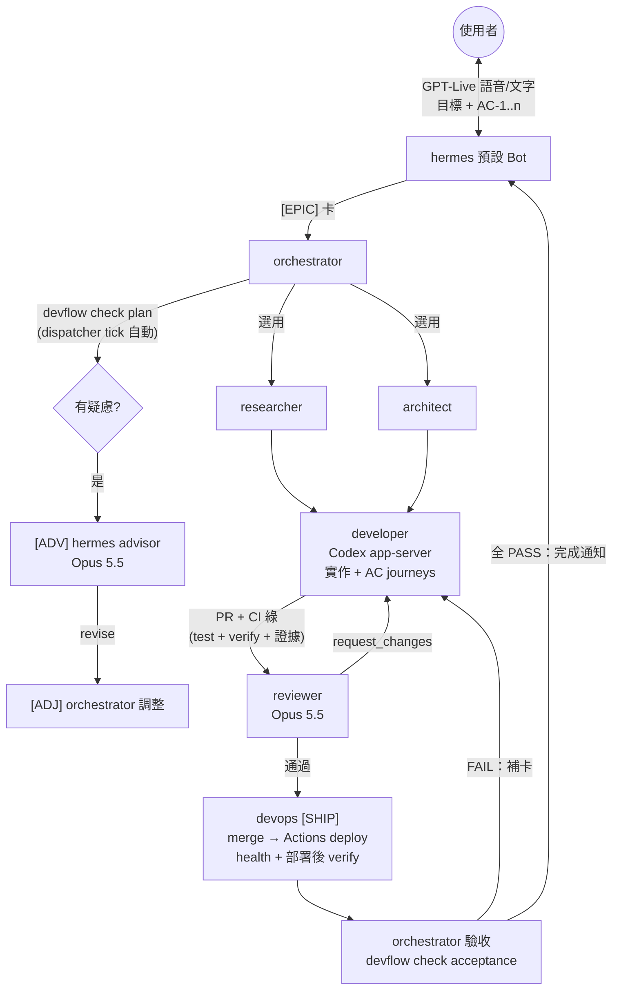

# devflow｜Hermes 七 Bot 共用開發流程

適用任何新 repo 或既有 repo。只用 Hermes 原生功能（Kanban、dispatcher、profile、skills、Codex app-server runtime、GPT-Live 語音），不改 Hermes 程式。

## 流程

- **一個 repo = 一個 Kanban board**；卡片依賴就是流程，dispatcher（default gateway 內）依依賴自動派工。
- 卡片 body（目標/驗收/提示）是規格；`kanban_complete` / `kanban_request_review` 的 summary + metadata 是交接。沒有額外交接文件。
- **驗收貫穿全程**：Hermes 把「怎樣算完成」寫成編號 `AC-n`（可觀察結果，語音確認一次）→ 子卡標「覆蓋：AC-n」→ repo 的 `.devflow/verify.sh` 一條 AC 一個 journey（UI 用 Playwright 截圖）在 PR CI 與部署後各跑一次，證據存 Actions artifact → orchestrator 用 `devflow check acceptance` 逐條判定，全 PASS 才完成 EPIC。
- **計畫檢查**：EPIC 等子卡期間，計畫一有變動（建卡、改卡、`[ADJ]` 調整），dispatcher tick 自動跑 `devflow check plan`：規則（卡型、assignee、workspace、contract、`[SHIP]`、parent 鏈、AC 覆蓋）+ Decisions API 風險分數；有新疑慮才建 `[ADV]` 給 Hermes（Opus 5.5）判斷，同樣的疑慮不重複送。只有「含不可回復操作」時 `[ADV]` 擋 `[SHIP]`，其他情況不擋。
- **看板自動化**：default profile 的 shell hook `on_kanban_dispatch_tick` 在 gateway 內的 dispatcher 每個 tick 觸發 `devflow tick`（board 沒變動就立即結束；有變動才背景執行，不拖慢派工）。它做兩件事：計畫檢查，以及執行 orchestrator 在自己卡上留的 `devflow-ops`（edit / archive / link / unlink / assign / resume）。
- 不設次數/時間卡控：沒有 run budget、沒有輪詢 cron；review 退件不限次數；失敗卡由 Hermes 自動轉 `[ADJ]` 給 orchestrator，只有需要使用者決定的事才問人。檢查工具出錯時只記錄，不擋流程。

## 七個 Bot

| Bot（profile） | 職責 | 卡片 | 主要技能 |
|---|---|---|---|
| hermes（default） | GPT-Live 語音/文字入口、把需求寫成 AC、建 EPIC、回報進度、Advisor（`[ADV]` 卡用 Opus 5.5） | `[ADV]` | devflow-intake；mattpocock grilling/grill-me/to-questionnaire/wait-what/teach/ask-matt；pstack in-your-own-words/bro/ketchup/how/why/sharpen… |
| orchestrator | 拆解（吞吐檢查）、AC 覆蓋、串依賴、等待、逐條驗收、處理失敗 | `[EPIC]` `[ADJ]` | devflow-orchestrate；to-tickets/to-spec/wayfinder；pstack figure-it-out/sequence-verifiable-units/outcome-oriented-execution/encode-lessons-in-structure… |
| researcher | 一手來源、方案比較、PoC | `[RES]` | devflow-research；research/prototype；pstack how/why/explain-the-number… |
| architect | 架構、模組邊界、資料模型、介面、ADR | `[ARCH]` | devflow-architect；codebase-design/domain-modeling/improve-codebase-architecture；pstack architect/statechart/boundary-discipline… |
| developer | Codex app-server 在 worktree 實作、測試、AC journeys、PR、CI | `[DEV]` | Codex skill `ub-mode`（寫程式規則）；devflow-develop；implement/tdd/diagnosing-bugs/pr；pstack prove-it-works/migrate-callers/create-verification-skill… |
| reviewer | 獨立審查（不同 GitHub 帳號、Opus 5.5，Copilot 不可用時退回 Codex）、跑測試、不提交的獨立探測、看證據、approve 或退件 | review 欄 | devflow-review；ub-mode（同一份規則審 Make it Right）；code-review/diagnosing-bugs；pstack interrogate/blast-radius/correct… |
| devops | repo 接入、runner、merge、部署、回滾 | `[OPS]` `[SHIP]` | devflow-devops；wizard/diagnosing-bugs/pr；pstack make-operations-idempotent/build-the-lever/encode-lessons-in-structure… |

pstack 24 條 principle 每條至少分配給一個 Bot（developer 的部分由 Codex 的 ub-mode 承擔）。分配只代表可用；流程中一定要用的，直接寫在 devflow skill 的步驟裡並註明 principle 名：orchestrator（attack-the-premise、sequence-verifiable-units、encode-lessons-in-structure）、researcher（explain-the-number）、architect（model-the-domain、boundary-discipline）、reviewer（minimize-reader-load）、devops（make-operations-idempotent、explain-the-number、encode-lessons-in-structure）。

完整分配見 `roles.json`。pstack 透過 plugin 載入，每個 profile 以 `skills.disabled` 只留分配到的；mattpocock 技能 vendor 在 `vendor/mattpocock-skills`，以 `roles/<role>/` 符號連結經 `skills.external_dirs` 提供。

**ub-mode**（[unclebob/ub-mode](https://github.com/unclebob/ub-mode) @ `3da62bf`，MIT，原文放在 `skills/ub-mode/`）：
- 主要開發在 Codex，所以 install 把它複製到 developer 的 `$CODEX_HOME/skills/ub-mode`（Codex 原生 skill，`skills/list` 可見），並只移走具名項目（`roles.json` `obsolete_skills.codex`）：舊契約的 `seven-pstack-*`、`team-operations`，以及規則已由 ub-mode 負責的 Codex 複本 `test-driven-development`（「一律先寫測試」與 ub-mode「寫不出誠實測試就不寫」衝突）、`pstack/skills/{tdd,principle-fix-root-causes,principle-test-behavior-not-implementation}`。補充而不衝突的 `systematic-debugging`、`principle-prove-it-works` 與其他既有 Codex 技能保留。`codex/AGENTS.md` 要求每次改程式都套用 ub-mode，並覆寫與 devflow 衝突的條目：只 push 卡片分支走 PR（原文是 push 到 main line）、worktree 由 Hermes 管、Keep a Log 寫進 handoff metadata `log`。
- reviewer 用同一份 skill 審 Make it Right。developer Hermes profile 的 pstack 分配移除了 ub-mode 已涵蓋的 principle（laziness、subtract、boundary、idempotent、type-system、fix-root-causes、test-behavior、tdd），避免兩套規則。
- ub-mode 的 Crapper / Dryer / Mutator 是第三方程式，只在 PR CI 的 `quality` job（GitHub-hosted、唯讀 token、pinned commit）執行，不在 Hermes 容器執行。結果是 artifact `devflow-quality-<sha>` 與 run summary，供 developer 修正、reviewer 參考；不在 `devflow-ci` 的 `needs` 內，不擋合併。

## CI/CD

| 階段 | 執行位置 | 內容 |
|---|---|---|
| PR CI | GitHub-hosted `ubuntu-latest` | `test`：`.devflow/test.sh` + `docker build`；`verify`：`.devflow/up.sh` 起服務 → `.devflow/verify.sh`（AC journeys，UI 用 Playwright 官方映像）→ artifact `devflow-evidence-pr-<sha>`，失敗時 `.devflow/capture.sh` → `devflow-diagnostics-pr-<sha>`；`quality`：`.devflow/quality.sh`（ub-mode 指標，不擋）→ artifact `devflow-quality-<sha>`；彙總 job `devflow-ci` 是 default branch 的 required check |
| Deploy | Oracle VM 主機 `devflow` 使用者（rootless Docker）上的 self-hosted runner `[self-hosted, devflow]` | `.devflow/deploy.sh`：compose build → up → health → `verify.sh`；up / health / verify 失敗先採證再回滾，build 失敗不動執行中版本；artifact `devflow-evidence-deploy-<sha>`、`devflow-diagnostics-deploy-<sha>` |
| Repro（除錯） | GitHub-hosted `ubuntu-latest`，`workflow_dispatch` | `repro.yml`：任一分支起服務、只跑指定 AC（`DEVFLOW_ONLY`）、全程 trace、採證 → artifact `devflow-repro-<run>`。developer 用它在 Hermes 外重現整合層問題，不碰正式主機、沒有部署秘密 |

**診斷與除錯**：`capture.sh` 只讀（容器清單、`State` 的退出碼/OOM/健康/重啟次數、限時 log、健康探測、主機磁碟/記憶體），不輸出 `Config.Env`；`redact.py` 以 `deploy/.env` 的值與常見憑證樣式遮罩，遮罩失敗就刪 log。遮罩是盡力而為，應用程式仍不應記錄秘密。診斷 artifact 與 AC 證據分開，保留 7 天。

**信任邊界**：workflow YAML 的條件（`if`、`environment`、`concurrency`）只防誤用，不是安全邊界。有任一 devflow repo push 權限的帳號，都能在分支上寫 workflow 跑在 `[self-hosted, devflow]` runner，等同主機 `devflow` 使用者與其 rootless Docker 的權限；所有 repo 共用這個使用者與 Docker daemon。要收斂需另做主機隔離（每個 repo 獨立使用者與 Docker，或組織層級 runner group 限定 workflow）。

- repo 契約：`templates/repo/`（`devflow contract <slug> . [--ui]` 補進 repo，列出與範本不同的檔供既有 repo 升級）。契約合併後 devops 跑 `devflow repo protect <slug>`，之後 PR 卡由 Hermes 原生 contract 強制 exact-head CI 全綠才能完成。
- Runner：`devflow repo add` 自動申請（`--no-runner` 跳過）；手動補 `devflow runner request OWNER/REPO`。請求放在 `/opt/data/devflow/runner/requests/`，主機 `devflow-runner-requests.path` 觸發 `runner-host.sh` 註冊並啟動 `devflow-runner@<owner>__<repo>`（user systemd），狀態看 `devflow runner status OWNER/REPO`。
- 服務只綁 `127.0.0.1:<port>`（`devflow repo add` 分配，從 18100 起）。

## 身分與權限
- GitHub：builder = devops/gh 帳號（hermes、orchestrator、researcher、architect、developer、devops）；reviewer = reviewer/gh 帳號。`devflow repo add` 會讓兩個帳號都有 push 權限。
- developer 的 Codex：workspace-write 沙箱 + 網路；`.git` 在沙箱內唯讀，git/gh 以 Codex 原生升權執行，developer profile `approvals.mode: off` 自動核准（使用者 2026-11-15 選定）。
- developer 模型必須在 Codex app-server 的 `model/list` 內（ChatGPT 帳號登入的 Codex 不支援 `gpt-6.1-sol`）；`roles.json` 固定為 `gpt-6-astra`，換模型先用 developer 的 Codex 確認。
- Opus 5.5 走 `github-copilot` plugin（provider `copilot`，憑證在 Hermes 原生 credential pool）。reviewer profile 預設 Opus、`fallback_providers` 退回 `openai-codex`；`[ADV]` 卡由 `devflow check plan` 以卡片 model/provider 覆寫指定 Opus。
- Decisions API（`roles.json` 的 `decisions`）用 Hermes 既有 OpenAI key（GPT-Live 同一把）；`check plan` 的 `flag`、`check acceptance` 的 `pass` 為機率門檻。

## Hermes 原生限制與對應（不改 Hermes 程式）
| 原生行為 | 影響 | devflow 對應 |
|---|---|---|
| PR `completion_contract` 以卡片 assignee 的 GitHub 身分讀 required checks（classic branch protection 只有 admin 讀得到；ruleset 任何協作者都讀得到） | 沒有 required checks、或 reviewer（非 admin）完成時看不到 classic protection，卡永遠完成不了 | `devflow repo protect` 建 ruleset `devflow`（default branch 必須 `devflow-ci`，admin 可 bypass），成功才標 `contract=yes`；`[DEV]`/`[OPS]` 依此設 contract，否則 local-only，由 reviewer / devops 用 `gh` 核對 |
| dispatcher 派出的 worker 寫入看板只能透過 `kanban_*` 工具；`hermes kanban` CLI 的寫入（edit、archive、unlink、assign、unblock）與 `kanban list`（會重算 ready）在 worker 內被 Hermes 擋下 | orchestrator 在 `[EPIC]`/`[ADJ]` 不能改寫、封存、解除依賴或重跑別張卡；worker 內的 hook 也被擋 | orchestrator 留 `devflow-ops` 留言；default profile 的 `on_kanban_dispatch_tick` hook（在 gateway dispatcher 內，不受 worker 限制）由 `devflow tick` 執行。devflow 讀看板只用 `kanban show` |
| 留言含 PR 網址的卡，dispatcher 24 小時內不重派（除非有交接事件）；unblock 不重設失敗計數 | 開過 PR 後 block / crash 的卡 unblock 了也不會跑 | `resume`（block → 取消指派 → 指派回原 Bot → unblock）：Hermes 聊天用 `devflow resume`，orchestrator 用 `devflow-ops` |
| Codex app-server 用 ChatGPT 帳號，只接受 `model/list` 內的模型 | developer 用 `gpt-6.1-sol` 時每次 run 立即失敗 | developer `model.default` 固定 `gpt-6-astra` |

## 新 repo / 既有 repo
跟 Hermes 說「幫 OWNER/REPO 做 X」或「開一個新專案 NAME 做 Y」。Hermes 會 `devflow repo add`（新專案加 `--create`）並建 EPIC；orchestrator 判斷需不需要接入 CI/CD（`[OPS]`）或骨架（`[ARCH]`→`[DEV]`）。

## 檔案
| 路徑（容器內 `/opt/data/devflow/`） | 內容 |
|---|---|
| `roles.json` | 角色、技能分配、設定 |
| `souls/` | 各 Bot SOUL（install 時寫入 `<profile>/SOUL.md` 的 devflow 區塊） |
| `skills/` | devflow 團隊技能 |
| `bin/devflow` | repo / board / contract / runner / check plan / check acceptance / tick CLI |
| `bin/codex-developer` | developer 的 Codex 啟動器 |
| `codex/AGENTS.md` | developer Codex 全域指示 |
| `gitconfig` | 所有 Bot 共用的 git 設定（`GIT_CONFIG_GLOBAL`，經 `gh auth git-credential` 取憑證） |
| `templates/repo/`、`templates/ui/` | repo 契約（CI/CD、deploy、test、verify）與 Playwright UI journeys 骨架 |
| `install.py` | 套用到 7 個 profile（冪等；舊設定備份到 `/opt/data/devflow-backup/<時間>/`） |
| `state/repos.json` | 已接入 repo 與埠 |

主機端：`host/setup-host.sh`、`host/runner-host.sh`（本機 repo），由 `deploy-kit.sh --host` 安裝。只改 skills/CLI/templates 時用 `deploy-kit.sh --kit-only`；改 `roles.json`、SOUL 後用 `deploy-kit.sh` 並重啟 gateway（`s6-svc -r /run/hermes-service/gateway-default`）。
